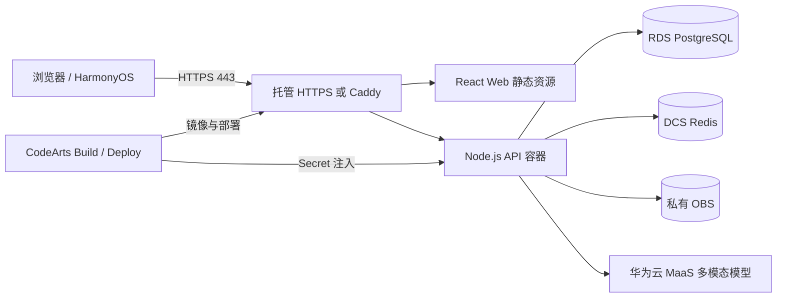

# Birdfolio Cloud 比赛架构

状态：目标架构；云资源尚待人工开通和验证。

## 华为云能力与业务价值

| 能力 | 用途 | 不可替代的证据 |
|---|---|---|
| ECS + Docker | 承载 Web、API 和 HTTPS 入口 | 容器状态、版本与回滚记录 |
| RDS PostgreSQL | 账号、观察、识别请求的持久化 | 迁移记录与重启后数据 |
| DCS Redis | 原子限流、验证码、短期 AI 候选缓存 | readiness 与命中/未命中测试 |
| 私有 OBS | 媒体对象存储 | 私有策略与认证读取验证 |
| MaaS | 输出最多 3 个鸟种候选与辨识特征 | provider/modelVersion/耗时日志 |
| CodeArts | 辅助开发、构建与部署 | 真实提示词、提交、流水线记录 |

## 关键数据流

1. 浏览器本地缩放图片并通过 Canvas 重绘移除 EXIF。
2. 认证 API 接收图片，校验类型、尺寸和像素后写入私有 OBS。
3. API 用短期受控方式把媒体交给 MaaS，密钥不下发客户端。
4. 模型候选与粗粒度时间、地区、栖息地规则共同排序。
5. 用户确认后才生成观察；不把模型输出冒充事实。
6. 社区输出和敏感记录只使用降精度位置。

## 安全边界

- 公网仅开放 443；8787、RDS、DCS 均限制在私网/安全组内。
- OBS 禁止公共读写，不向浏览器暴露永久凭据。
- CodeArts Secret 保存生产凭据，仓库只提交空值示例。
- Redis 不保存照片、Token 或精确坐标。
- Release 日志只记录请求 ID、路由模板、状态、耗时和错误类别。
- 比赛快捷登录只能在 competition profile 开启，商业 profile 启动前必须拒绝。

## 暂不宣称

当前不得宣称高可用、商业 SLA、大规模并发、识别准确率或真实用户留存；这些需要部署和样本评测后才能给出数据。
